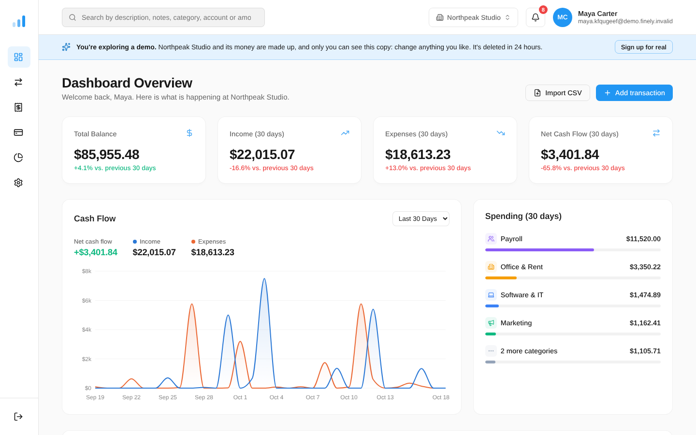
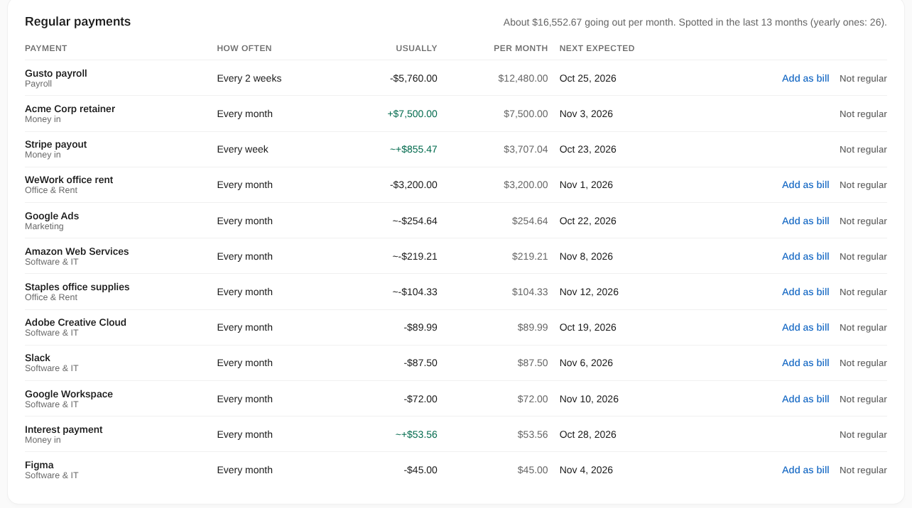
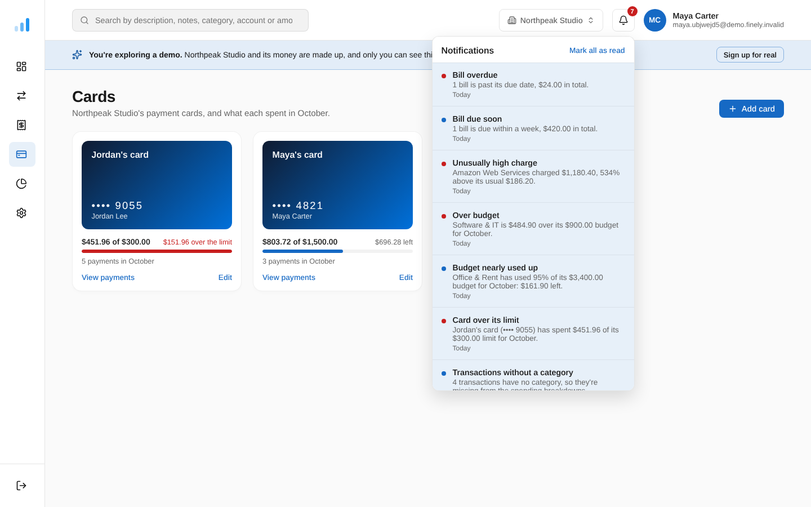
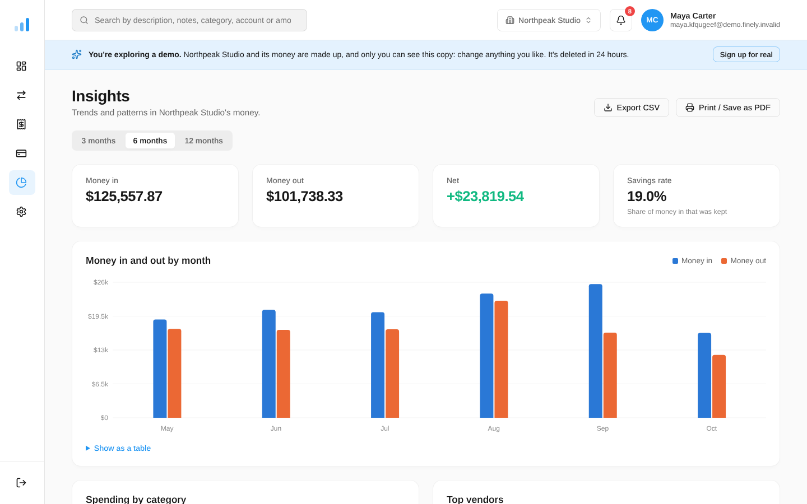
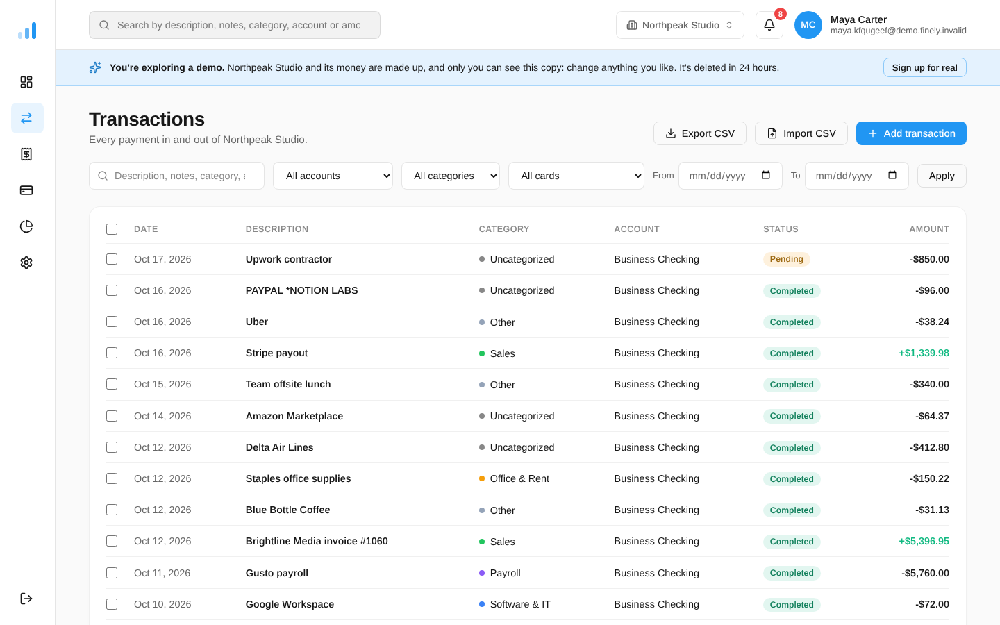
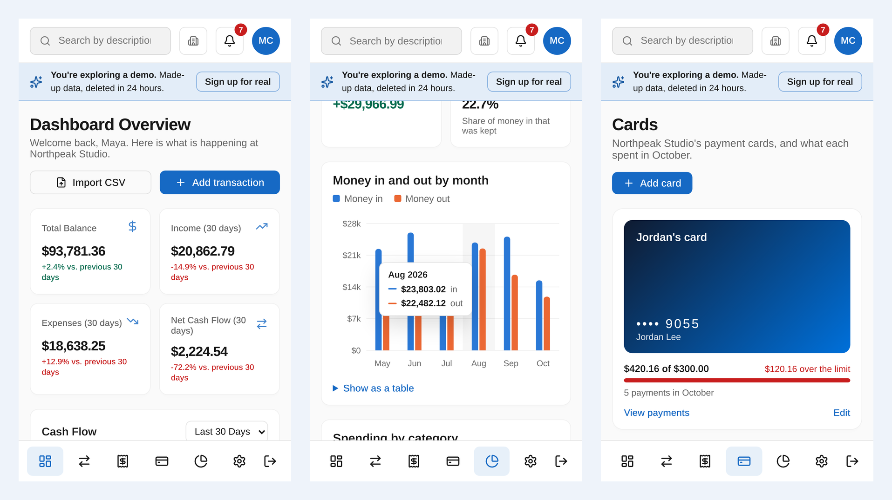

# Finely

[](https://github.com/cihan286/finely/actions/workflows/ci.yml)
[](https://finely-lemon.vercel.app)


Financial clarity for modern businesses. Finely is a SaaS app that helps
businesses track expenses, follow their cash flow and turn financial data into
actionable insights.

**[Open the live app →](https://finely-lemon.vercel.app)** and press **Try the
demo**: no sign-up, you're logged in to a pretend design studio with half a
year of sample data, and only you see your copy.



*A portfolio project, built to the standard of a real SaaS product. See
[Known limitations](#known-limitations) for what it would still need before
real customers.*

## What it does

- **Companies and teams.** Everyone works inside a company, with owners,
  admins, accountants, members and viewers, invitations by email, handing
  a company over and deleting it. One person can belong to several companies.
- **Money in and out.** Bank accounts, transactions added by hand, imported
  from any bank's CSV export (columns are recognized automatically) or synced
  from a linked bank through Plaid. Categories, rules that categorize new
  transactions, attached receipts and payment cards with monthly limits.
- **Insights.** A dashboard of balances and cash flow; trends over 3, 6 or 12
  months; top vendors; **regular payments it finds by itself** (rent,
  payroll, subscriptions, a client on a retainer); **unusually high
  charges**; a 30-day balance forecast; budgets per category and overall.
- **Staying on top of it.** Bills with due dates, which payments arriving
  from the bank mark as paid; a notification bell; a weekly summary email and
  alerts; an activity log of who changed what; exports to CSV.
- **Paid plans** through Stripe, with a team-size limit per plan.
- **English and Turkish**, switched with one click: every page, email,
  export and error message, with each language's number and date formats.

<table>
  <tr>
    <td></td>
    <td></td>
  </tr>
  <tr>
    <td align="center"><sub>Regular payments, found from the transactions alone</sub></td>
    <td align="center"><sub>Card limits, and what the bell warns about</sub></td>
  </tr>
  <tr>
    <td></td>
    <td></td>
  </tr>
  <tr>
    <td align="center"><sub>Insights over 3, 6 or 12 months</sub></td>
    <td align="center"><sub>Transactions: search, filter, categorize several at once</sub></td>
  </tr>
</table>



## How it's built

- **Next.js 16** (App Router, Server Components and server actions) with
  React 19 and the React Compiler, in strict TypeScript.
- **Postgres on Neon** through Drizzle ORM, with migrations applied on every
  deploy. Money is stored as exact decimals; every company has its own
  timezone, which decides the day each transaction falls on.
- **Multi-tenant by design.** Every query is scoped to the signed-in
  person's company on the server, and a test suite runs the real data code
  against an in-memory Postgres to prove that one company can never read or
  change another's data, and that each role can do only what it may.
- **Real integrations.** Better Auth (email and Google sign-in, sessions,
  organizations), Stripe subscriptions with signed webhooks that ignore late
  or repeated messages, Plaid bank linking with access tokens encrypted
  (AES-256-GCM), Resend for email, Sentry for errors (set up to send no
  personal or financial data).
- **Security.** A strict Content Security Policy (only scripts carrying a
  one-time code per page load can run, so an injected script can't),
  security headers, login, sign-up and contact-form rate limiting, roles
  checked on the server for every action, and a demo that can't email,
  invite or pay for anything.
- **Two languages, done properly.** Typed dictionaries (a sentence missing
  in Turkish doesn't compile), each person's language saved for the emails
  sent to them, and an activity log stored as what happened rather than as
  text, so every reader sees it in their own language. Browser code only
  gets the words it needs.
- **Accessible.** The public pages, company setup, and every page, main
  dialog and the notifications panel of the demo pass axe's WCAG 2.1 AA checks in both
  light and dark mode (text contrast, names for every button and field,
  headings), checked on every push.
- **Tested.** 336 unit tests (Vitest) for the calculations and the data
  rules, and 25 end-to-end tests (Playwright) that use the real app in a
  real browser against a real Postgres: signing up, importing a statement,
  inviting a teammate, Stripe's messages, the demo, phone-sized screens,
  the page layout and accessibility.
  GitHub Actions runs everything, plus a type check, lint, a production
  build and a check that every schema change has a migration, on every push.
  Dependabot keeps dependencies up to date.
- Hosted on **Vercel**, with daily and weekly jobs (bank sync, the weekly
  summary, deleting expired demos).

## Tech stack

- [Next.js 16](https://nextjs.org) (App Router) with React 19 and the React Compiler
- TypeScript (strict mode)
- [Better Auth](https://www.better-auth.com) for authentication (email + password, Google)
- [Neon](https://neon.tech) Postgres with [Drizzle ORM](https://orm.drizzle.team)
- [Resend](https://resend.com) for emails (verification, password reset, invitations)
- CSS Modules with shared design tokens
- [Sentry](https://sentry.io) for error monitoring
- [Vercel](https://vercel.com) for hosting, GitHub Actions for CI
- [Recharts](https://recharts.org) for charts
- [Lucide](https://lucide.dev) for icons ([react-icons](https://react-icons.github.io/react-icons/) for brand logos)

## Running it locally

You need Node.js 20.9 or newer and a [Neon](https://neon.tech) database (the
free plan is enough). Copy `.env.example` to `.env.local` and set
`DATABASE_URL` and `BETTER_AUTH_SECRET`. Everything else is optional; the
[development guide](docs/development.md#getting-started) explains each value.

```bash
npm install
npm run db:migrate
npm run dev
```

Open [http://localhost:3000](http://localhost:3000) and sign up.

## Documentation

- **[Development](docs/development.md)**: setup, scripts, project
  structure, code conventions and tests
- **[Features in detail](docs/features.md)**: how accounts, the demo,
  imports, billing, linked banks, bills, cards, budgets, emails and the
  insights work
- **[Deploying](docs/deploying.md)**: Vercel and Neon setup, scheduled jobs,
  security headers and the Content Security Policy
- **[ERP roadmap](docs/erp-roadmap.md)** (Turkish): the plan for growing
  Finely into an ERP, phase by phase

## Known limitations

Finely is a portfolio project. It aims to have what a SaaS app for
businesses needs, and it isn't meant to be run for paying customers as it
is. What's missing at that level:

- **Payment cards** are for keeping track of cards the company's bank
  issued: Finely doesn't issue cards, and a limit warns but can't stop a
  payment. A card is only recognized in a description that shows its last
  four digits.
- **Currencies:** one per company. There are no accounts in other
  currencies and nothing is converted.
- **Bills** can't be paid in parts. A payment that arrives pays its bill by
  itself only when the amount is exact and the description contains the
  bill's name; otherwise it's pointed out for a person to confirm.
- **Budgets** are the same every month: unused money doesn't carry over and
  one month can't have a different amount.
- **Vendors and regular payments** are recognized by description. Different
  spellings of one vendor ("AMZN", "Amazon") count as different vendors and
  can't be merged by hand, and a regular payment's rhythm or amount can't be
  corrected (only hidden).
- **The forecast** knows unpaid bills, pending payments and regular
  payments, not one-off income or day-to-day spending.
- **Notifications:** only unusual charges are emailed right away, and the
  weekly summary goes out at the same moment whatever the company's
  timezone.
- **Linked banks** were only tried in Plaid's sandbox: US banks, everyday
  and savings accounts. A bank that asks to log in again has to be linked
  again, and syncing is once a day or on demand.
- **Plans** were only tried in Stripe's test mode. They differ in team size
  only, are priced in US dollars and have no free trial.
- **Attached files** are kept in the database, and PDFs have no preview.
- **Your account:** someone who signs in with Google can't add a password.
- **Exports** are CSV files, plus the browser's "Save as PDF" on the
  Insights page.
- **Deleting a company** is immediate: there's no grace period.
- **Languages:** English and Turkish only. Categories, the demo's sample
  data and activity log lines from before both languages existed stay in
  the language they were written in.
- **Terms and privacy** describe what the app really does in plain words;
  they aren't legal documents.

## Author

Designed and built by **Cihan Işık**
([LinkedIn](https://www.linkedin.com/in/cihan-i%C5%9F%C4%B1k-1490b33a7),
[GitHub](https://github.com/cihan286)).
Questions or feedback are welcome through
[GitHub issues](https://github.com/cihan286/finely/issues).
